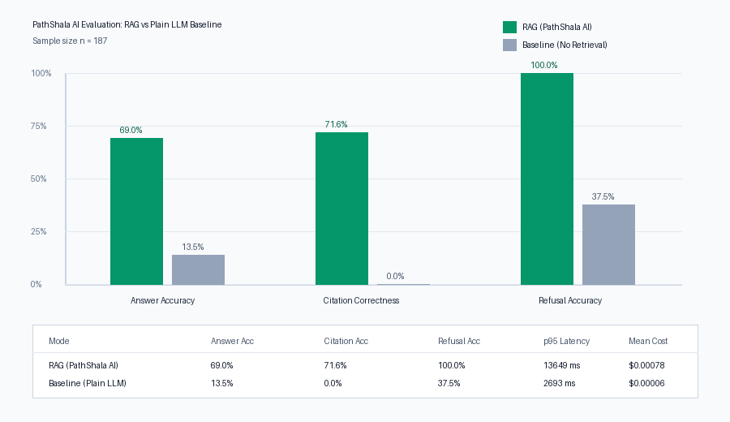

# PathShalaAI (পাঠশালা AI)

**PathShalaAI does not simply give students answers. It identifies why they do not understand a concept and helps them learn it using their actual NCTB textbook.**

- **Live Web UI (Vercel):** https://web-xi-peach-30.vercel.app
- **API Docs (Swagger):** https://pathshala-ai-g087.onrender.com/docs

---

## Feature Readiness Status (Honest Matrix)

| Status | Implemented & Verified Capabilities |
|---|---|
| **Working Now** | • **Multi-Version NCTB Isolation:** Separate `curriculum_id`, `textbook_medium` (`bangla_version` vs `english_version`), `class_level`, `subject`, and independent `answer_language` (`bn` / `en`). • **Ingested Corpus (`112` books, `50,532` chunks):** `33` Bangla Version books (Classes 1–5: `7,081` `bge-m3` embedded chunks) + `79` English Version books (Classes 1–10: `43,451` FTS-indexed chunks with chapter `page_start`–`page_end`; `1,093` priority `bge-m3` vectors in Class 8 Science & Classes 1–2 Math). • **Concept Rescue Loop:** `ASK -> EXPLAIN -> CHECK -> DIAGNOSE -> RE-TEACH -> PRACTICE -> TRACK` via `/concept-rescue/check` and `/concept-rescue/submit` with cautious `Likely misconception:` labels. • **PostgreSQL Mastery Persistence:** Idempotent `learning_events` (`event_key`) and `session_mastery` surviving restarts + `DELETE /session/{session_id}`. • **Child Safety & Privacy:** Pre-retrieval Bangla/English/Banglish distress gate (`1098` Child Helpline), non-logging of distress queries, PII scrubbing (`scrub_pii`), 2 MB in-memory photo OCR, small-cohort (`<3`) teacher privacy suppression. • **Teacher Learning-Gap Dashboard (`/teacher`):** Incorrect-answer rates with sample counts, recurring misconceptions, chapter refusal heatmap, top questions, CSV export, clearly labeled Demo Data (`session_id='seed'`). • **Custom MCP Server (`nctb-corpus`):** 4 read-only stdio tools (`search_textbook`, `get_chapter`, `list_chapters`, `explain_citation`). |
| **In Progress** | • Generating `BAAI/bge-m3` embeddings for remaining English Version subjects beyond Class 8 Science & Classes 1–2 Math (currently served via Postgres FTS). • Running full live LLM benchmark over the new `eval/golden_set_v2.jsonl` (`n=205`). |
| **Planned** | • Ingesting Classes 6–10 Bangla Version (`51,791` chunks currently on disk in `data/raw/mendeley`). • Teacher-reviewed distractor misconception banks per subject. • Offline cached quiz packs beyond the current PWA app-shell cache (`web/public/sw.js`). |

---

## Concept Rescue Demo Journey (Example Flow)
1. Select **Textbook: `English Version`**, **Class `8`**, **Subject `Science`**, and **Answer Language: `বাংলা (Bangla)`**.
2. Ask: `What is diffusion and how does it work in plants?`
3. Read the Bangla explanation grounded in Class 8 Science Ch. 3 (`Diffusion, Osmosis and Transpiration`, `pp. 30–39`).
4. Click **Concept Check** -> select an incorrect distractor -> view the cautious **Likely Misconception**, a simpler grounded re-explanation, and a fresh practice MCQ on the same learning objective.
5. Answer the follow-up MCQ correctly and watch the **Estimated Practice Mastery (EWMA)** update in PostgreSQL.
6. Visit `/teacher` to see aggregate learning gaps and recurring misconceptions (demo rows are explicitly tagged `ডেমো ডেটা`).

See [docs/DEMO_SCRIPT.md](docs/DEMO_SCRIPT.md) for full presenter and offline fallback steps.

---

## Architecture & Documentation
- **System Architecture & Migrations:** [docs/ARCHITECTURE.md](docs/ARCHITECTURE.md)
- **Repository Audit (Phase 0):** [docs/ANTIGRAVITY_AUDIT.md](docs/ANTIGRAVITY_AUDIT.md)
- **Corpus & Ingestion Report:** [docs/DATA_REPORT.md](docs/DATA_REPORT.md)
- **Evaluation Methodology & Results:** [docs/EVAL_REPORT.md](docs/EVAL_REPORT.md)
- **Responsible AI, Child Safety & Provider Data Flow:** [docs/RESPONSIBLE_AI.md](docs/RESPONSIBLE_AI.md)
- **Engineering Decisions:** [docs/DECISIONS.md](docs/DECISIONS.md)
- **Business & Pilot Plan:** [docs/BUSINESS.md](docs/BUSINESS.md)

---

## Measured Evaluation (v1 Historical Baseline, `n = 187`)
Evaluated on `eval/golden_set.jsonl` (`155` answerable Classes 1–5 Bangla Version + `32` off-syllabus). See [docs/EVAL_REPORT.md](docs/EVAL_REPORT.md).

| Metric | RAG (`PathShalaAI`) | Baseline (`Plain LLM`) |
|---|---:|---:|
| Sample size (`n`) | 187 | 187 |
| **Answer Accuracy** (`155` answerable) | **69.0%** (`107/155`) | 13.5% (`21/155`) |
| **Citation Correctness** (`155` answerable) | **71.6%** (`111/155`) | 0.0% |
| **Refusal Accuracy** (`32` off-syllabus) | **100.0%** (`32/32`) | 37.5% (`12/32`) |
| p95 Latency | 13,649 ms | 2,693 ms |
| Mean Cost / Query | \$0.00078 | \$0.00006 |

- **Red-Team Safety Check (`scripts/redteam.py`):** **50/50 PASS** across Bangla/English/Banglish distress (`1098`), jailbreak, prompt injection, inappropriate, political, medical, and Class 6+ off-syllabus prompts.

---

## Quickstart & Migrations
1. Configure `.env` (`GEMINI_API_KEY`, `DATABASE_URL` with `pgvector`).
2. Apply schema / migrations idempotently:
   `python -c "from pathshala.db import apply_migrations; print(apply_migrations())"`
3. Ingest datasets:
   - Bangla Version (Classes 1–5): `python -m ingest.run --data data/raw/mendeley --medium bangla_version --max-class 5 --no-ctx`
   - English Version (Classes 1–10 FTS + page ranges): `python -m ingest.run --data data/raw/NCTB-SchoolText-English --medium english_version --max-class 0 --no-ctx --fts-only`
   - Optional priority vectors: `python -m ingest.run --data data/raw/NCTB-SchoolText-English --medium english_version --max-class 0 --classes 8 --subjects science --no-ctx`
4. Optional Concept Rescue demo seed (`session_id='seed'`): `python scripts/seed_demo.py`
5. Run Backend & Frontend:
   - `uvicorn pathshala.api:app --reload --port 8000`
   - `npm --prefix web run dev`
6. Run Verification:
   - `python -m unittest discover -s tests -t . -q`
   - `python -m ruff check pathshala ingest eval mcp_server tests`
   - `npm --prefix web run lint && npm --prefix web run build`

---

## Data Attribution & Licence
- **Datasets:** NCTB-PrimaryText / NCTB-SchoolText (Bangla & English Version chunks; Mendeley Data DOI `10.17632/w3hj4m45d9.1`, CC BY 4.0). Not redistributed in git.
- **Code:** MIT ([LICENSE](LICENSE)).
