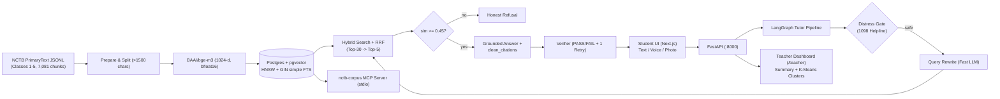

# PathShalaAI (পাঠশালা AI)

**30-Second Pitch:** PathShalaAI is a Bangla adaptive AI tutor grounded strictly in Bangladesh's NCTB primary textbooks (Classes 1–5, 7,081 indexed chunks). Students ask by text, voice, or textbook photo and receive step-by-step answers with verifiable chapter/chunk citations—or an honest refusal when the topic is not in the book. Includes adaptive EWMA chapter mastery, practice questions, a child-safety distress gate (`1098`), a teacher analytics dashboard, and a custom MCP server (`nctb-corpus`).

- **Live Demo:** https://web-xi-peach-30.vercel.app (UI toggle: বাংলা / English)
- **API Docs (Swagger):** https://pathshala-ai-g087.onrender.com/docs

### Try These 3 Sample Questions
| Class & Subject | Question | Expected Behavior |
|---|---|---|
| Class 5 · Science | `খাদ্যশৃঙ্খল কাকে বলে?` | Cited Bangla answer from Class 5 Science + expandable source snippet + optional English explanation |
| Class 5 · BGS | `লালবাগ কেল্লা কোথায় অবস্থিত?` | Cited Bangla answer from Class 5 BGS with chapter & chunk reference |
| Class 5 · Science (Off-syllabus) | `কোয়ান্টাম কম্পিউটার কীভাবে কাজ করে?` | Honest refusal (`এই প্রশ্নের উত্তর পাঠ্যবইয়ে খুঁজে পাইনি।`) — zero hallucinated citations |

## Quickstart
1. Configure `.env` (`GEMINI_API_KEY`, `DATABASE_URL` with `pgvector`) and place the Mendeley dataset under `data/raw/mendeley/`.
2. `bash scripts/setup.sh`
3. `make db` (or apply `db/schema.sql`) · `python -m ingest.run --no-ctx` (or `make ingest`)
4. `make api` (FastAPI on `:8000`) · `make web` (Next.js on `:3000`)
5. `make verify` · `make eval`

## Architecture

## Evaluation (Measured on `n = 187` Golden Set)
Evaluated with `make eval` on `eval/golden_set.jsonl` (`155` answerable across Classes 1–5 + `32` off-syllabus). See [docs/EVAL_REPORT.md](docs/EVAL_REPORT.md) for details and 3 failure examples.

| Metric | RAG (`PathShala AI`) | Baseline (`Plain LLM`) |
|---|---:|---:|
| Sample size (`n`) | 187 | 187 |
| **Answer Accuracy** (`155` answerable) | **69.0%** (`107/155`) | 13.5% (`21/155`) |
| **Citation Correctness** (`155` answerable) | **71.6%** (`111/155`) | 0.0% |
| **Refusal Accuracy** (`32` off-syllabus) | **100.0%** (`32/32`) | 37.5% (`12/32`) |
| p95 Latency | 13,649 ms | 2,693 ms |
| Mean Cost / Query | \$0.00078 | \$0.00006 |

## Layout
`pathshala/` core (`api`, `pipeline`, `retrieval`, `db`, `llm`, `embed`, `text`, `practice`, `clustering`) · `ingest/` · `eval/` · `mcp_server/` · `web/` · `prompts/` · `db/schema.sql` · `automation/n8n/` · `scripts/` · `tests/` · `docs/`

## MCP Server (`nctb-corpus`)
Custom FastMCP stdio server in `mcp_server/server.py` (config snippet in `mcp_server/mcp_config.snippet.json`). Run directly with `python -m mcp_server.server`.
- **Tools (read-only):**
  - `search_textbook(query, class_level, subject=None, k=5)` — hybrid vector + FTS RRF search over NCTB textbook chunks.
  - `list_chapters(book_id)` — chapter numbers, titles, and chunk counts for a textbook.
  - `get_chapter(book_id, chapter_no)` — all chunks in a textbook chapter.
  - `explain_citation(chunk_id)` — full source chunk and metadata (`class_level`, `subject`, `chapter`, `chunk_ref`, `text`) behind a citation.
- **Database permissions:** use a read-only Postgres role in production:
  `create role mcp_ro login password '...'; grant select on chunks, textbooks to mcp_ro;`
- **Build disclosure:** custom `nctb-corpus` MCP server is provided in `mcp_server/`; no external third-party MCP servers were enabled during the build.

## Privacy, Safety & Limitations
- **Safety & Privacy:** No user accounts, names, or phone numbers are collected; uploaded photos (`/ask-image`, 2 MB limit) are transcribed in memory and never saved; distress keywords immediately return a calm helpline message (Child Helpline `1098`).
- **Teacher Dashboard (`/teacher`):** Read-only without authentication for demo convenience; synthetic demo rows are explicitly flagged with `session_id='seed'` and separated from real queries in the UI.
- **Honest Limitations:**
  - Source math/religion OCR contains noise; dataset chunks have **no page numbers**, so citations use class, subject, chapter, and `chunk_ref`.
  - Scoped to **Primary Classes 1–5** (`7,081` chunks); contextualisation was kept OFF (`--no-ctx`, see `docs/DECISIONS.md` D9).
  - Automated `eval/run_eval.py` uses strict substring `keyword_recall >= 0.5`, which under-counts valid Bangla paraphrases.

## Data & Licence
**Dataset:** Badar, Mir Hossain Ahmed, Pervaj Ahmed Tuhin. *NCTB-PrimaryText: A Curriculum-Aligned Textbook Chunk Dataset for Bangla and English Primary Education.* Mendeley Data, V1, 2026. DOI 10.17632/w3hj4m45d9.1. Licence CC BY 4.0 (https://data.mendeley.com/datasets/w3hj4m45d9/1). Not redistributed here.
**Code:** MIT (`LICENSE`).
