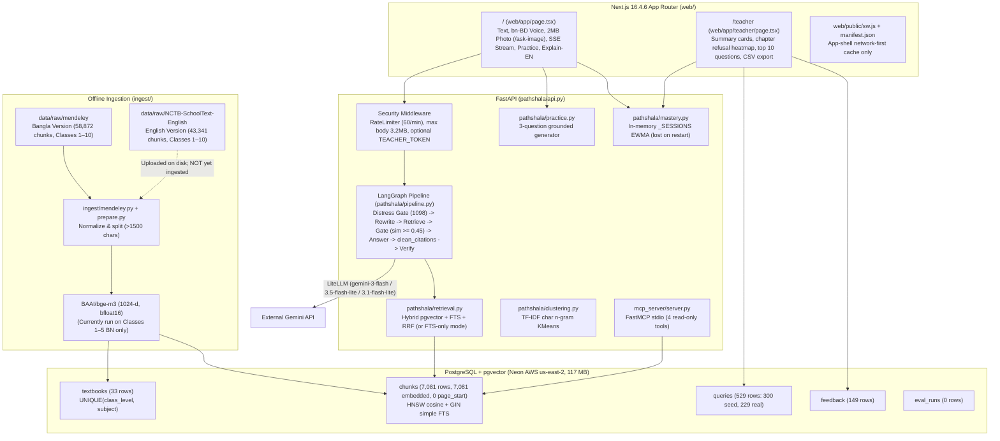

# PathShalaAI — Repository Audit & Implementation Plan (Phase 0)

**Audit Date:** 2026-11-21  
**Repository:** `https://github.com/MaHdIn2020/PathShala-AI` (branch: `main`, HEAD at audit: `99dc772`)  
**Scope:** Read-only verification of backend, database, corpus on disk vs. live DB, frontend, evaluation suite, and operations prior to code/schema edits.

---

## 1. Verified Architecture Diagram

---

## 2. Verified Current Feature Matrix

| Area | Feature / Component | Status | Verified Implementation Evidence |
|---|---|---|---|
| **Backend & RAG** | FastAPI app (`/health`, `/ask`, `/ask/stream`, `/ask-image`, `/search`, `/practice`, `/explain-en`) | **Implemented** | `pathshala/api.py`; SSE `/ask/stream` chunks buffered response after `pipeline.answer()` |
| **Backend & RAG** | LangGraph tutor pipeline (`rewrite -> retrieve -> answer -> check_cites -> verify`) | **Implemented** | `pathshala/pipeline.py`; supports 1 verify retry, in-memory `_CACHE` |
| **Backend & RAG** | Hybrid retrieval (`pgvector` cosine + Postgres `simple` FTS + RRF + `fts_search`) | **Implemented** | `pathshala/retrieval.py`; `RERANK=0` in `.env` (`bge-reranker-v2-m3` optional) |
| **Backend & RAG** | Citation provenance reconstruction (`clean_citations`) | **Implemented** | Rebuilds citation fields strictly from retrieved DB chunks; discards invented IDs |
| **Backend & RAG** | Safe arithmetic evaluator (`safe_eval_expr`) | **Implemented (Not Wired)** | `pathshala/math_tool.py` exists and is unit-tested, but not invoked inside `pipeline.py` |
| **Curriculum Identity** | Separate `curriculum_id` and `textbook_medium` (`bangla_version` vs `english_version`) | **Not Implemented** | `db/schema.sql` has `unique (class_level, subject)` on `textbooks`; no medium column |
| **Curriculum Identity** | Separate textbook medium from answer explanation language | **Partial** | Only post-hoc `/explain-en` translation exists; cannot select EN textbook + BN explanation |
| **Curriculum Identity** | Chapter page range metadata (`page_start`, `page_end`) | **Broken / Dropped** | `chapters_config_*.json` has `start_page`/`end_page`, but `ingest/mendeley.py` skips them (`chunks_with_pages = 0`) |
| **Curriculum Identity** | Collision-free `chunk_ref` across Bangla & English versions | **Broken** | Both `mendeley` and `NCTB-SchoolText-English` use identical `chunk_id` format e.g. `3-Science-1-1` |
| **Concept Rescue** | Interactive loop (`ASK -> EXPLAIN -> CHECK -> DIAGNOSE -> RE-TEACH -> PRACTICE -> TRACK`) | **Not Implemented** | Only static 3-question recall/understanding/application list via `/practice`; no misconception diagnosis or re-teach |
| **Mastery** | Anonymous EWMA mastery tracking & CSV export | **Partial** | `pathshala/mastery.py` uses in-memory `_SESSIONS` dict only; lost on restart, no idempotency key |
| **Teacher Dashboard** | Summary metrics, chapter refusal heatmap, top 10 questions, K-means clusters | **Implemented** | `web/app/teacher/page.tsx` + `db.teacher_summary()`; separates `session_id='seed'` vs real |
| **Teacher Dashboard** | Concept-level misconception analytics & small-cohort privacy suppression | **Not Implemented** | No `learning_events` table, no misconception aggregation, no `min_group_size` suppression |
| **Frontend & UX** | Student chat UI (Bangla/EN toggle, `bn-BD` voice, 2MB photo, PWA shell) | **Implemented** | `web/app/page.tsx` (1,065 lines); class selector hardcoded `[1, 2, 3, 4, 5]`; offline shell only |
| **Evaluation** | Golden set (`n=187`, Classes 1–5 BN) & RAG vs baseline results | **Implemented** | `eval/golden_set.jsonl`, `eval/results.json`: `69.0%` acc, `71.6%` cite, `100%` refusal (`32/32`), `13,649 ms` p95 |
| **Safety & Privacy** | Pre-retrieval child distress gate (`1098` helpline) & 50-item safety suite | **Partial** | `is_distress_query()` works for BN/EN/Banglish, but `api.py` logs distress queries into `queries` and lacks PII scrubbing |
| **MCP Server** | Custom read-only stdio MCP (`search_textbook`, `get_chapter`, `list_chapters`, `explain_citation`) | **Implemented** | `mcp_server/server.py` (unit-tested in `tests/test_mcp_server.py`) |

---

## 3. Curriculum Inventory (Actual Measured Data)

### 3.1 Live PostgreSQL Database (Neon `ep-holy-wildflower-bd58gkrq`)
- **Total DB size:** `117 MB`
- **Tables:** `textbooks` (33 rows), `chunks` (7,081 rows; 7,081 with `embedding`, 0 with `page_start`), `queries` (529 rows: 300 `seed`, 229 real), `feedback` (149 rows), `eval_runs` (0 rows).
- **Ingested coverage:** Classes 1–5 Bangla Version only (`Class 1`: 3 books, `Class 2`: 3 books, `Class 3`: 9 books, `Class 4`: 9 books, `Class 5`: 9 books). Classes 6–10 and English Version are **0% ingested**.

### 3.2 On-Disk Datasets (`data/raw/`)

| Class | Bangla Version (`data/raw/mendeley`) Chunks | Bangla Subjects (count) | English Version (`data/raw/NCTB-SchoolText-English`) Chunks | English Subjects (count) |
|---|---:|---:|---:|---|
| Class 1 | 166 | 3 (`bangla`, `english`, `math`) | 101 | 1 (`math`) |
| Class 2 | 279 | 3 (`bangla`, `english`, `math`) | 168 | 1 (`math`) |
| Class 3 | 1,709 | 9 (`bangla`, `bgs`, 4 religions, `english`, `math`, `science`) | 1,919 | 7 (`bgs`, 4 religions, `math`, `science`) |
| Class 4 | 2,255 | 9 (same as Class 3) | 2,365 | 7 (same as Class 3) |
| Class 5 | 2,665 | 9 (same as Class 3) | 2,804 | 7 (same as Class 3) |
| Class 6 | 7,005 | 22 | 5,753 | 13 |
| Class 7 | 8,377 | 22 | 6,504 | 13 |
| Class 8 | 9,357 | 22 | 6,812 | 13 (incl. `science`: 822 chunks) |
| Class 9–10 (`classNineTen`) | 27,059 | 33 | 16,915 | 17 |
| **Total** | **58,872** | **134 books** | **43,341** | **79 books** |

*Note on Class 9–10:* Both datasets label SSC books `"class": "9-10"`, which `ingest/mendeley.py:to_int()` parses as `class_level = 9`.  
*Note on Page Numbers:* Every subject folder includes `chapters_config_<subject>.json` with `chapter_no`, `chapter_title`, `start_page`, `end_page`, which `ingest/mendeley.py` currently skips.

---

## 4. Top 10 Technical & Product Risks (Ranked by Severity)

1. **[P0 / Critical] Textbook & Chunk Identity Collision (`textbooks` and `chunks`)**: `textbooks` has `UNIQUE (class_level, subject)` and `chunks` has `UNIQUE (chunk_ref)` where both BN and EN datasets generate identical refs (`3-Science-1-1`). Ingesting English Version as-is would overwrite Bangla Version textbooks and chunks.
2. **[P0 / Critical] Missing Retrieval Version Isolation**: `pathshala/retrieval.py` filters only on `class_level` and `subject`. Without `curriculum_id` and `textbook_medium` filters, English and Bangla Version chunks would mix during retrieval.
3. **[P0 / High] Conflated Textbook Medium & Explanation Language**: The API and UI assume Bangla textbook = Bangla answer (plus post-hoc `/explain-en`). There is no clean support for selecting *NCTB English Version Class 8 Science* and receiving a grounded *Bangla* explanation (or vice versa).
4. **[P0 / High] Volatile In-Memory Mastery State**: `pathshala/mastery.py` keeps `_SESSIONS` only in process memory; server restarts/redeploys wipe student progress and teacher aggregate mastery, and `/practice/attempt` has no idempotency protection.
5. **[P0 / High] Incomplete Signature Pedagogical Loop (Concept Rescue)**: Currently `/practice` generates static Q&A cards without interactive MCQ evaluation, likely-misconception diagnosis, grounded re-teaching, or objective-matched follow-up practice.
6. **[P0 / High] Child-Safety & PII Gaps in Logging**: `pathshala/api.py` calls `db.log_query()` without scrubbing phone numbers/emails/names, and teacher analytics lacks small-cohort suppression (`min_group_size`).
7. **[P1 / Medium] Dropped Chapter Page Ranges**: `page_start` and `page_end` in `chunks` are all `NULL` even though `chapters_config_*.json` contains chapter `start_page`/`end_page`.
8. **[P1 / Medium] Cache Pollution Across Versions/Languages**: `pipeline.py` cache key uses `f"{q}|{class_level}|{subject}"`, omitting `curriculum_id`, `textbook_medium`, and `answer_language`.
9. **[P1 / Medium] Windows `.venv` Binary Mismatch & Local CPU Embedding Bottleneck**: Repo `.venv` targets Python 3.11 (`cp311`), whereas host runs Python 3.10 (`cp310`) and PostgreSQL 18 (`libpq.dll`). Also, local CPU `BAAI/bge-m3` took ~8.4h for 7,081 chunks (D13); computing vectors for all 43,341 EN chunks on CPU would stall delivery, requiring FTS indexing for all 43,341 chunks + targeted `bge-m3` embeddings for priority demo books.
10. **[P1 / Medium] Eval Metric Blindness & Missing Cross-Version Benchmark**: `eval/golden_set.jsonl` (`n=187`) covers only Classes 1–5 BN and relies primarily on strict keyword substring matching (`keyword_recall >= 0.5`), mis-scoring valid paraphrases and lacking leakage tests.

---

## 5. Existing Tests & Exact Commands

- **Unit test suite:** `tests/` (21 test files, 82 tests total covering `api_image`, `calibrate`, `chart`, `clustering`, `eval`, `eval_metrics`, `mastery`, `math_and_norm`, `mcp_server`, `mendeley`, `mendeley_real_shape`, `n8n_flows`, `pipeline`, `practice`, `prepare`, `probe_ask_cli`, `retrieval_llm`, `security`, `seed_queries`, `teacher_summary`, `text`).
  - Run (Windows Python 3.10): `C:\Users\USER\AppData\Local\Programs\Python\Python310\python.exe -m unittest discover -s tests -t . -q`
  - Run (Linux/CI): `bash scripts/verify.sh`
- **Linting:** `python -m ruff check pathshala ingest eval tests`
- **Frontend lint & build:** `npm --prefix web run lint && npm --prefix web run build`
- **Red-team safety suite (50 prompts):** `python scripts/redteam.py`
- **Evaluation:** `python -m eval.run_eval --api http://localhost:8000 --golden eval/golden_set.jsonl --out eval/results.json`

---

## 6. DB Migration Risks & Backward Compatibility

- **Existing Data Preservation:** Production DB holds 7,081 embedded Bangla Version chunks across 33 textbooks plus 529 query rows and 149 feedback rows. All migrations must use `ALTER TABLE ... ADD COLUMN IF NOT EXISTS` and `CREATE TABLE IF NOT EXISTS`—never `DROP TABLE` or `TRUNCATE`.
- **Constraint Transition:** Replacing `UNIQUE (class_level, subject)` on `textbooks` with `UNIQUE (curriculum_id, textbook_medium, class_level, subject)` safely preserves existing 33 rows (backfilled as `curriculum_id='nctb'`, `textbook_medium='bangla_version'`).
- **Storage Budget:** Live Neon Postgres is currently `117 MB` (free tier limit typically `512 MB`). Bulk-inserting 43,341 English Version chunks in FTS mode + priority `bge-m3` vectors for Class 8 Science & Classes 1–2 will be monitored with `pg_database_size` after ingestion.

---

## 7. Phased Implementation Plan (6 Checkpoints)

1. **Checkpoint 1 (Phase 0 — Current):** Audit repository & datasets (`docs/ANTIGRAVITY_AUDIT.md`), repair Python 3.10 test environment, update `.gitignore`.
2. **Checkpoint 2 (Phase 1):** Add `db/migrations/001_curriculum_identity.sql`, update `ingest/mendeley.py`, `ingest/run.py`, `pathshala/retrieval.py`, `pathshala/pipeline.py`, `pathshala/api.py`; backfill Bangla page ranges + ingest all 43,341 English Version chunks (FTS + priority `bge-m3` vectors for Class 8 Science & Classes 1–2); add `GET /curriculum/catalog` and `tests/test_curriculum_isolation.py`.
3. **Checkpoint 3 (Phase 2):** Add `db/migrations/002_concept_rescue_mastery.sql`, persist `learning_events` and `session_mastery` in Postgres (`pathshala/mastery.py`) with `event_key` idempotency and `DELETE /session/{session_id}`, implement `pathshala/concept_rescue.py` (`CHECK -> DIAGNOSE -> RE-TEACH -> PRACTICE -> TRACK`) and API routes, add `tests/test_concept_rescue.py`.
4. **Checkpoint 4 (Phases 3 & 7):** Upgrade Bangla/English/Banglish retrieval normalization (`pathshala/text.py`), short-chunk neighbor expansion (`pathshala/retrieval.py`), cache-key isolation (`pathshala/pipeline.py`), PII scrubbing + distress non-logging (`pathshala/security.py`, `pathshala/api.py`), prompt-injection hardening (`prompts/*.md`), and `docs/RESPONSIBLE_AI.md`.
5. **Checkpoint 5 (Phases 4 & 5):** Upgrade `web/app/page.tsx` with dynamic version/class/subject/answer-language selectors, verified citation/page metadata, interactive Concept Rescue panel, and session reset; upgrade `web/app/teacher/page.tsx` and `db.teacher_summary()` with Concept Rescue learning gaps, recurring misconceptions, and small-group suppression (`min_group_size=3`).
6. **Checkpoint 6 (Phases 6, 8 & 9):** Build versioned `eval/golden_set_v2.jsonl` (`n=205`) with cross-version leakage & false-refusal metrics (`eval/run_eval.py`), add stage latency breakdown + `/health/ready`, seed demo Concept Rescue data (`scripts/seed_demo.py`), run verification & eval checks, and finalize `README.md`, `docs/DEMO_SCRIPT.md`, `docs/ARCHITECTURE.md`, `docs/DATA_REPORT.md`, `docs/EVAL_REPORT.md`, and `docs/DECISIONS.md`.

---

## 8. Approved Team Decisions

- **A1 (Ingestion & Embeddings):** Ingest all 43,341 English Version chunks (Classes 1–10) immediately with FTS + chapter page ranges (`page_start`, `page_end`), and compute local `BAAI/bge-m3` vectors for priority demo textbooks (Class 8 Science English Version + Classes 1–2 English Version).
- **A2 (Curriculum Exposure):** Dynamically expose Classes 1–10 and subjects in the UI strictly from actual ingested textbooks via `GET /curriculum/catalog`.
- **A3 (Checkpoints & Git):** Commit and push cleanly to `origin/main` after each checkpoint while keeping local-only prompt/data files untracked.
