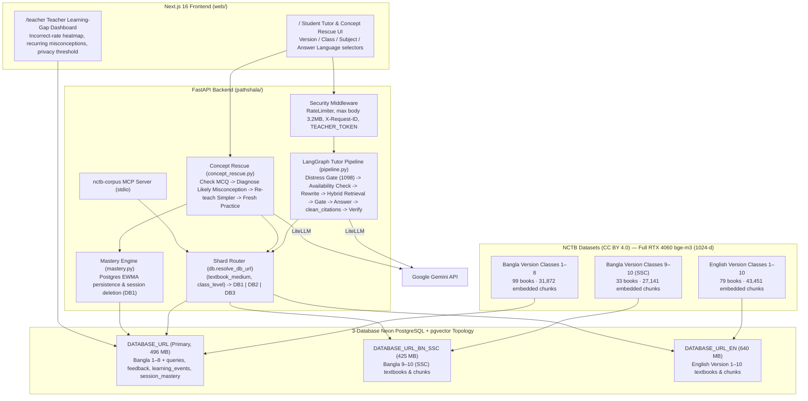

# PathShalaAI — System Architecture & Data Flow

## 1. End-to-End 3-Shard Architecture

## 2. 3-Database Shard Routing (`pathshala/db.py`)
- `resolve_db_url(textbook_medium, class_level, cfg)` routes every textbook read/write cleanly:
  - `("english_version", any class)` -> `DATABASE_URL_EN`
  - `("bangla_version", class >= 9)` -> `DATABASE_URL_BN_SSC`
  - `("bangla_version", class <= 8)` -> `DATABASE_URL` (Primary)
- Operational tables (`queries`, `feedback`, `eval_runs`, `learning_events`, `session_mastery`) always reside on the primary `DATABASE_URL`.
- When `DATABASE_URL_BN_SSC` and `DATABASE_URL_EN` are omitted or empty, `Config` automatically falls back to `DATABASE_URL` for seamless local single-DB development.
- `get_curriculum_catalog()` and `/health/ready` query all configured shards and merge books deterministically via `merge_shard_books()`, preferring the authoritative shard for each `(curriculum_id, textbook_medium, class_level, subject)`.

## 3. Curriculum Identity & Version Isolation
- `curriculum_id` (`nctb`), `textbook_medium` (`bangla_version` | `english_version`), `class_level`, `subject`, and `answer_language` (`bn` | `en`) are independent concepts.
- Every SQL retrieval query applies exact predicates `WHERE t.curriculum_id = %(curr)s AND t.textbook_medium = %(med)s AND t.class_level = %(cl)s AND (%(subj)s IS NULL OR t.subject = %(subj)s)` before ranking.
- English Version chunk refs carry the `en-` prefix (`en-8-Science-3-4`) so Bangla Version (`8-Science-3-4`) and English Version chunks never collide.
- `clean_citations()` verifies every cited `chunk_id` was retrieved in the current request and matches `expected_medium`.

## 4. Concept Rescue State Flow
`ASK -> EXPLAIN (in chosen answer_language) -> CHECK (4-option grounded MCQ) -> DIAGNOSE (cautious likely misconception) -> RE-TEACH (simpler grounded explanation) -> PRACTICE (fresh MCQ on same learning objective) -> TRACK (idempotent EWMA update in PostgreSQL)`

## 5. Database Migrations & Rollback Guidance
- Migrations live in `db/migrations/` and are applied idempotently across all unique shards via `pathshala.db.apply_migrations()`:
  - `schema.sql`: base extensions (`vector`), tables, HNSW vector index, and GIN `simple` FTS index.
  - `001_curriculum_identity.sql`: adds `curriculum_id`, `textbook_medium`, `edition_year`, `source_license` to `textbooks` and replaces `unique (class_level, subject)` with `unique (curriculum_id, textbook_medium, class_level, subject)`.
  - `002_concept_rescue_mastery.sql`: adds `learning_events` (with `unique (event_key)`) and `session_mastery`.
- **Rollback safety:** Because migrations are additive (`ADD COLUMN IF NOT EXISTS`, `CREATE TABLE IF NOT EXISTS`), rollback can drop the new tables (`learning_events`, `session_mastery`) or restore a pre-migration Neon snapshot without touching existing `chunks` or `textbooks`.
