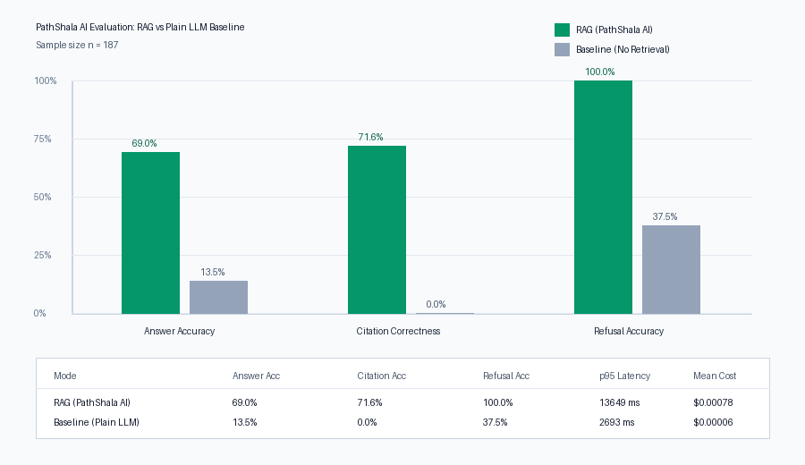

# Evaluation Report — PathShala AI

Measured from [eval/results.json](../eval/results.json) (RAG) and [eval/results_baseline.json](../eval/results_baseline.json) (plain LLM baseline, no retrieval) on [eval/golden_set.jsonl](../eval/golden_set.jsonl).

## 1. Method & Dataset
- **Golden set (`n = 187`):** `155` answerable questions across NCTB primary textbooks (Classes 1–5) + `32` off-syllabus questions (`answerable: false`).
- **Auto-draft + review disclosure:** Answerable rows were generated from corpus chunks (`prompts/eval_qa_gen.md`, filtered for meta-questions in `eval/generate_golden_set.py`); off-syllabus rows were authored manually across out-of-scope topics.
- **Metrics (`eval/run_eval.py`):**
  - `answer_accuracy`: fraction of answerable items not refused and achieving `keyword_recall >= 0.5`.
  - `citation_correctness`: fraction of answerable items not refused whose rebuilt citations include a `gold_chapters` or `gold_refs` match.
  - `refusal_accuracy`: fraction of off-syllabus items properly refused (`refused == true`).

## 2. Results (RAG vs Baseline)

| Metric | RAG (`PathShala AI`) | Baseline (`Plain LLM`) | Delta |
|---|---:|---:|---:|
| Sample size (`n`) | 187 | 187 | — |
| **Answer Accuracy** (155 answerable) | **69.0%** (`107/155`) | 13.5% (`21/155`) | +55.5 pts |
| **Citation Correctness** (155 answerable) | **71.6%** (`111/155`) | 0.0% | +71.6 pts |
| **Refusal Accuracy** (32 off-syllabus) | **100.0%** (`32/32`) | 37.5% (`12/32`) | +62.5 pts |
| p95 Latency (ms) | 13,649 ms | 2,693 ms | +10,956 ms |
| Mean Cost / Query (USD) | \$0.00078 | \$0.00006 | +\$0.00072 |

- Among the `155` answerable questions, RAG refused `34` (`21.9%`) and answered `121` (`78.1%`).
- Every off-syllabus question (`32/32`) was refused by RAG (`100.0%` refusal accuracy).

## 3. Three Real Failure Examples (`eval/results.json`)
1. **`q_011` (Class 5 `christian_religion`, ch 1)** — `"পাঠ কত?"` (`keywords`: `["পাঠ: ৮", "স্বীষ্টধর্ম শিক্ষা"]`) → `refused=True, cite_ok=False`.
   - *Cause:* Underspecified auto-generated question without chapter/topic context, combined with OCR spelling noise (`স্বীষ্টধর্ম`).
2. **`q_013` (Class 5 `christian_religion`, ch 2)** — `"চতুর্থ দিন বন্ধু কোথায় এসেছে?"` (`keywords`: `["স্কুলে এসেছে"]`) → `refused=True, cite_ok=False`.
   - *Cause:* Context-dependent fragment lacking entity names; hybrid retrieval score fell below `MIN_SCORE=0.45` or lacked sufficient context for the verifier.
3. **`q_014` (Class 5 `christian_religion`, ch 2)** — `"বন্ধুর সুস্থ হয়ে আসার পর প্রথম অনুভূতি কী ছিল?"` (`keywords`: `["ঈশ্বরকে ধন্যবাদ"]`) → `refused=False, cite_ok=True, correct=False`.
   - *Cause:* Pipeline retrieved and cited the exact right chapter (`ch 2`), but exact-substring `keyword_recall` missed synonymous Bangla phrasing in the generated answer.

## 4. Limitations
- **Keyword recall is strict:** Substring matching (`keyword_recall >= 0.5`) penalizes valid Bangla paraphrases and inflections (as seen in `q_014`, where citation correctness `71.6%` exceeds keyword accuracy `69.0%`).
- **OCR noise in source corpus:** Some primary Math and Religion chunks contain OCR artifacts that reduce retrieval similarity or trigger conservative `model_refused` / `verifier_fail` refusals.
- **No page numbers:** The Mendeley dataset lacks page numbers, so citations are verified at `(class, subject, chapter_no, chunk_ref)` granularity.
- **Latency:** Local CPU `BAAI/bge-m3` query embedding + rewrite + answer + verify pipeline yields `p95_latency_ms = 13,649 ms`.
